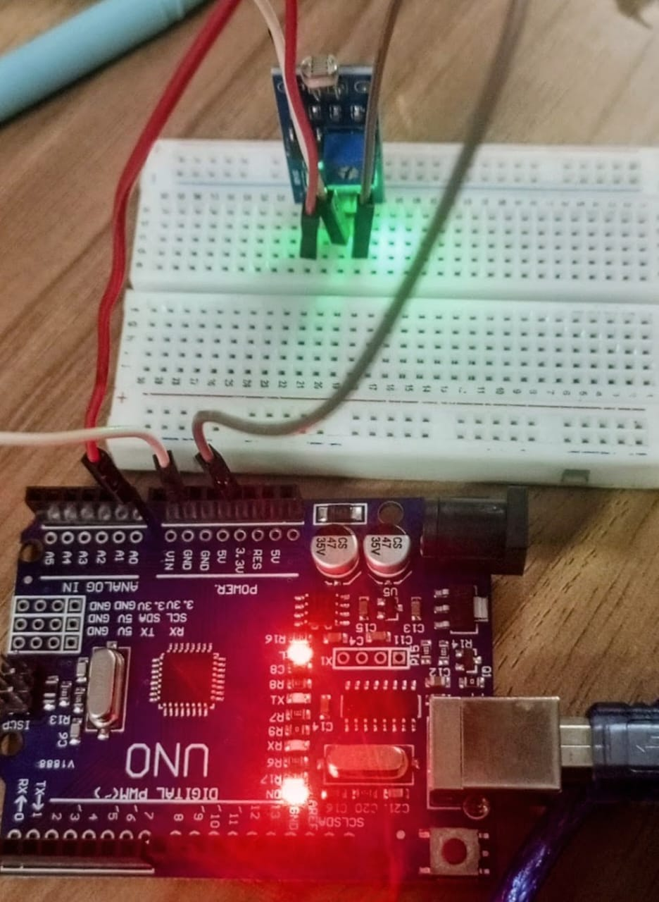

# 🌞 Arduino-Based LDR Light Intensity Monitoring System

### Real-Time Light Level Detection Using Arduino UNO and LDR Sensor

---

## 📌 About the Project

The **Arduino-Based LDR Light Intensity Monitoring System** is a simple electronics project designed to measure the surrounding light intensity using a Light Dependent Resistor (LDR) sensor. The LDR is connected to the analog pin A1 of the Arduino UNO to read variations in light levels.

The Arduino continuously processes the sensor readings and displays the corresponding analog values on the Serial Monitor. The readings are updated every 500 milliseconds, allowing users to observe changes in light intensity in real time.

This project demonstrates the fundamentals of analog sensor interfacing, data acquisition, and serial communication using Arduino.

---

## 🎯 Project Objectives

- To understand the working principle of an LDR sensor.
- To interface an LDR with an Arduino UNO.
- To measure variations in surrounding light levels.
- To display sensor readings through the Serial Monitor.
- To understand analog input reading and serial communication.

---

## ✨ Features

- **Light Intensity Detection:** Monitors surrounding light using an LDR sensor.
- **Analog Signal Reading:** Reads sensor values through Arduino analog pin A1.
- **Real-Time Monitoring:** Displays updated light readings continuously.
- **Serial Monitor Output:** Shows sensor readings using serial communication.
- **Automatic Data Updates:** Refreshes readings every 500 milliseconds.
- **Beginner-Friendly Design:** Simple circuit and code suitable for learning Arduino basics.
- **Low-Cost Implementation:** Uses basic and easily available electronic components.

---

## 🔧 Components Required

 Arduino UNO 
 
 LDR Sensor 
 
 10kΩ Resistor 
 
 Breadboard 
 
 Jumper Wires 
 
 USB Cable 

## ⚙️ Working Principle

1. The LDR sensor detects the surrounding light intensity.
2. The resistance of the LDR changes depending on the amount of light falling on it.
3. The sensor circuit produces a varying analog voltage.
4. Arduino reads the analog signal through pin A1 using `analogRead()`.
5. The measured value is displayed on the Serial Monitor.
6. The process repeats continuously with a delay of 500 milliseconds.

**Note:** The analog reading depends on the LDR circuit arrangement and surrounding lighting conditions. A higher reading does not always mean brighter light; it depends on how the LDR and resistor are connected.

##  Arduino Source Code

[View LDR Monitoring Arduino Code](./LDR_pin.ino)

## 📸 Project Output

## SERIAL MONITOR OUTPUT
Output

##  Concepts Learned

- Arduino UNO programming
- LDR sensor interfacing
- Analog input reading
- `analogRead()` function
- Serial communication
- Real-time sensor monitoring
- Basic electronic circuit connections

---

##  Future Improvements

- Add an LED that automatically switches ON in darkness.
- Display light intensity on an LCD or OLED screen.
- Develop an automatic street lighting system.
- Integrate IoT features for remote light monitoring.
- Add data logging for long-term light intensity analysis.

---

## Applications

- Automatic street lighting systems
- Smart home lighting
- Light intensity monitoring
- Automatic night lamps
- Energy-saving lighting systems
- Educational electronics projects

---

##  Acknowledgement

This project was developed as part of learning Arduino programming and sensor interfacing. It provides practical knowledge of analog signal measurement and real-time monitoring.

---

### 🔖 Tags

`Arduino UNO` `LDR Sensor` `Light Intensity Monitoring` `Embedded Systems` `Analog Sensor` `Electronics Project` `Arduino Projects`
